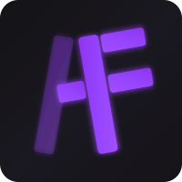

# <p align="center">ArgonFetch Website</p>

<p align="center">
  
</p>

<p align="center">
  Official website for <strong>ArgonFetch</strong> - A powerful media downloader for videos, music, and more.
</p>

<p align="center">
  <a href="https://www.argonfetch.dev/"></a>
  <a href="https://github.com/ArgonFetch/ArgonFetch"></a>
</p>

---

## 📋 About

This repository contains the source code for the ArgonFetch presentation website built with Angular. The website showcases the ArgonFetch media downloader, its features, installation instructions, screenshots, and more.

## 🛠️ Tech Stack

- **Framework**: Angular 19
- **Styling**: SCSS
- **Icons**: Font Awesome

## 🚀 Getting Started

### Prerequisites

- Node.js (v18+)
- npm or yarn

### Installation

1. Clone this repository
   ```sh
   git clone https://github.com/ArgonFetch/ArgonFetchWebsite.git
   cd ArgonFetchWebsite
   ```

2. Install dependencies
   ```sh
   npm install
   ```

3. Start the development server
   ```sh
   npm start
   ```

4. Open your browser at `http://localhost:4200`

## 🏗️ Building for Production

```sh
npm run build:prod
```

The build artifacts will be stored in the `dist/` directory.

## 📱 Features of the Website

- Responsive design for all devices
- Interactive UI components
- Detailed installation instructions for ArgonFetch
- Feature showcase
- Screenshot gallery
- Usage guide
- Project roadmap

## 📂 Project Structure

```
src/
├── app/                  # Angular components
│   ├── features/         # Features section
│   ├── hero/             # Hero banner section
│   ├── installation/     # Installation guide section
│   ├── navbar/           # Navigation bar
│   ├── roadmap/          # Project roadmap section
│   ├── screenshots/      # Screenshots gallery
│   ├── shared/           # Shared components & utilities
│   └── usage/            # Usage guide section
├── styles/               # Global styles
└── public/               # Static assets
```

## 📜 License

This project is licensed under the GPL-3.0 License. 
See the [LICENSE](LICENSE) file for more details.

---

<p align="center">Made with ❤️ by <a href="https://github.com/Pianonic">PianoNic</a> and <a href="https://github.com/MyDrift-user">MyDrift</a></p>
